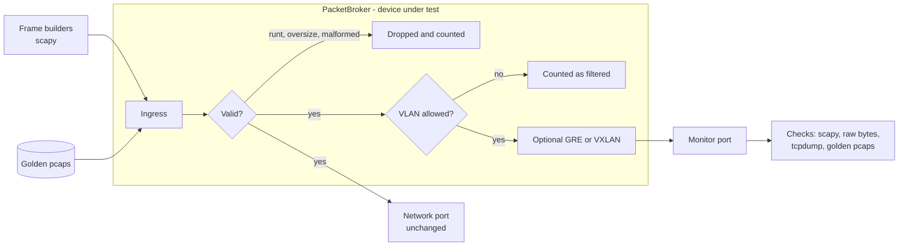
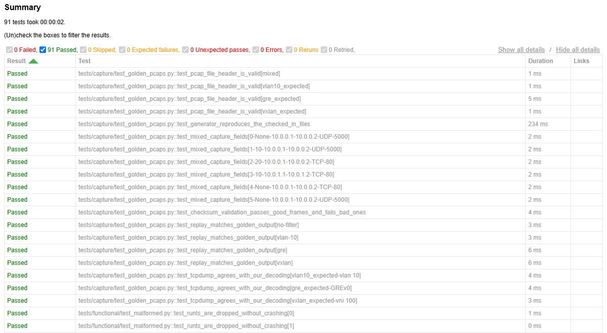

# packet-broker-qa-lab

[](https://github.com/KKoygun/packet-broker-qa-lab/actions/workflows/ci.yml)

**This is a personal learning and portfolio project.** It is a tiny software model of a packet
broker, not a real network device, and I built it to practise testing network behaviour.

The broker mirrors traffic to a monitor port, filters by VLAN and can tunnel the mirrored
frames in GRE or VXLAN. Most of the project is the QA suite that tests it.

## Architecture



The integration tests run the same broker over real Linux veth pairs, with one network namespace
each for the traffic source (`pb-src`), the broker (`pb-dut`) and the monitor (`pb-mon`).

## Layout

| Path | Contents |
| --- | --- |
| `src/broker/` | Frame builders, broker, tunnels, pcap and namespace helpers |
| `tests/` | `unit`, `functional`, `capture`, `tunnel` and `integration` tests |
| `robot/` | Robot Framework suite and its Python keyword library |
| `scripts/` | Golden pcap generator and the namespace setup script |
| `golden/` | Reference pcap files |
| `docs/` | [Test strategy](docs/test-strategy.md) and [test plan](docs/test-plan.md) |

## How to run

You need Python 3.12. Tests that do not need root also run on Windows. Use Linux or WSL for the
namespace tests.

```bash
python3.12 -m venv .venv
source .venv/bin/activate
pip install -e ".[dev]"
```

Lint and test. Tests that need root skip themselves:

```bash
ruff check . && ruff format --check .
pytest
```

Run everything, including the veth tests, and write an HTML report:

```bash
sudo .venv/bin/python -m pytest --html=report/index.html --self-contained-html
```

Run the Robot Framework suite:

```bash
sudo .venv/bin/python -m robot --outputdir report/robot robot/
```

Regenerate the golden files, which is only needed after an intended behaviour change:

```bash
python scripts/generate_golden_pcaps.py
```

Bring the lab network up or down by hand:

```bash
sudo bash scripts/netns_setup.sh up
sudo bash scripts/netns_setup.sh down
```

## Test report

CI publishes the [latest report](https://kkoygun.github.io/packet-broker-qa-lab/) to GitHub Pages.



## Limits

A software model cannot show line-rate behaviour, timing accuracy or anything about real
hardware. Frames here have no FCS, so the minimum size is 60 bytes rather than 64. The strategy
document lists what is out of scope.
